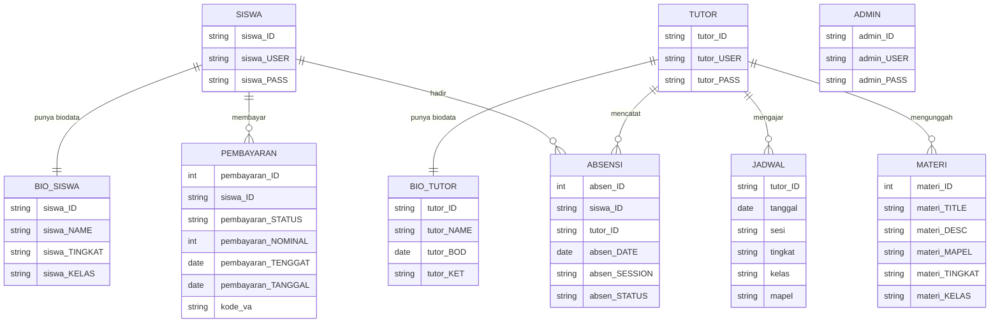

# Bimbel EduZone

Sistem informasi bimbingan belajar berbasis web. Admin mengelola data siswa, tutor, jadwal, dan pembayaran. Tutor mencatat kehadiran dan mengunggah materi. Halaman publik memperkenalkan bimbel dan menyediakan login serta registrasi.

## Fitur

**Halaman publik** (`frontend/`)
- Landing page bimbel
- Login dan registrasi

**Admin** (`admin/`)
- Dashboard ringkasan
- CRUD data siswa, tutor, jadwal, dan pembayaran
- Laporan dan laporan kehadiran
- Pengaturan akun

**Tutor** (`tutor/`)
- Dashboard
- Input, ubah, dan hapus materi (PDF dan video)
- Pencatatan dan daftar kehadiran siswa
- Pengaturan akun

**Siswa** (`siswa/`)
- Pengaturan akun

## Teknologi

- PHP (MySQLi)
- MySQL / MariaDB
- HTML, CSS, JavaScript, Bootstrap

## Struktur

```
frontend/   # halaman publik (landing, login, registrasi)
admin/      # panel admin
tutor/      # panel tutor
siswa/      # akun siswa
includes/   # koneksi database
template/   # potongan halaman bersama (head, menu, footer)
assets/     # CSS, JavaScript, dan gambar
uploads/    # materi yang diunggah tutor (tidak di-commit)
login.php   # login untuk admin dan tutor
```

## Diagram database

Relasi di bawah disusun dari query di kode PHP. Tabel di database tidak memakai foreign key, jadi hubungannya dibaca dari nama kolom.



Tipe data pada diagram adalah perkiraan, bukan hasil ekspor dari database.

## Cara menjalankan

1. Pasang XAMPP (atau PHP + MySQL lain), lalu jalankan Apache dan MySQL.
2. Salin folder proyek ini ke `htdocs`.
3. Buat database bernama `eduzone` di phpMyAdmin, lalu buat tabel sesuai diagram di atas. File SQL belum disertakan di repo ini.
4. Sesuaikan koneksi di `includes/config.php`, `admin/includes/config.php`, dan `tutor/includes/config.php` (bawaan: `localhost`, user `root`, tanpa password, database `eduzone`).
5. Buka `http://localhost/<nama-folder>/frontend/index.php` untuk halaman publik atau `http://localhost/<nama-folder>/login.php` untuk login admin dan tutor.

## Catatan

- Berkas yang diunggah tutor disimpan di `uploads/materi/` dan sengaja tidak masuk ke Git karena bisa berisi data pribadi.
- Konfigurasi database bawaan hanya untuk pengembangan lokal.
- Aplikasi ini dibuat sebagai proyek kuliah dan belum layak dipakai di server publik: password disimpan dan dibandingkan sebagai teks biasa, dan query disusun langsung dari input pengguna (rentan SQL injection).
