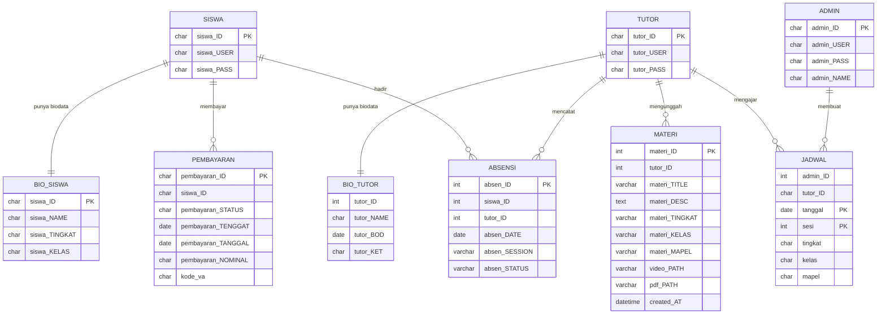

# Bimbel EduZone

Sistem informasi bimbingan belajar berbasis web. Admin mengelola data siswa, tutor, jadwal, dan pembayaran. Tutor mencatat kehadiran dan mengunggah materi. Halaman publik memperkenalkan bimbel dan menyediakan login serta registrasi.

## Fitur

**Halaman publik** (`frontend/`)
- Landing page bimbel
- Login dan registrasi

**Admin** (`admin/`)
- Dashboard ringkasan
- CRUD data siswa, tutor, jadwal, dan pembayaran
- Laporan dan laporan kehadiran
- Pengaturan akun

**Tutor** (`tutor/`)
- Dashboard
- Input, ubah, dan hapus materi (PDF dan video)
- Pencatatan dan daftar kehadiran siswa
- Pengaturan akun

**Siswa** (`siswa/`)
- Pengaturan akun

## Teknologi

- PHP (MySQLi)
- MySQL / MariaDB
- HTML, CSS, JavaScript, Bootstrap

## Struktur

```
frontend/   # halaman publik (landing, login, registrasi)
admin/      # panel admin
tutor/      # panel tutor
siswa/      # akun siswa
includes/   # koneksi database
template/   # potongan halaman bersama (head, menu, footer)
assets/     # CSS, JavaScript, dan gambar
uploads/    # materi yang diunggah tutor (tidak di-commit)
login.php   # login untuk admin dan tutor
```

## Diagram database

Kolom dan tipe data diambil dari skema di `database/eduzone.sql` (kolom `video_FILENAME` dan `pdf_FILENAME` pada `MATERI` tidak digambar). Tabel tidak memakai foreign key, jadi relasinya dibaca dari nama kolom dan query di kode PHP.



## Cara menjalankan

1. Pasang XAMPP (atau PHP + MySQL lain), lalu jalankan Apache dan MySQL.
2. Salin folder proyek ini ke `htdocs`.
3. Impor database: buka phpMyAdmin, pilih tab **Import**, lalu pilih file `database/eduzone.sql`. File ini membuat database `eduzone` beserta 9 tabelnya dan mengisinya dengan data contoh fiktif. Kalau database `eduzone` sudah ada, hapus dulu (`DROP DATABASE eduzone;`) supaya impor tidak gagal.
4. Sesuaikan koneksi di `includes/config.php`, `admin/includes/config.php`, dan `tutor/includes/config.php` (bawaan: `localhost`, user `root`, tanpa password, database `eduzone`).
5. Buka `http://localhost/<nama-folder>/frontend/index.php` untuk halaman publik atau `http://localhost/<nama-folder>/login.php` untuk login admin dan tutor.

Akun contoh: admin `admin@example.com` / `admin123`, tutor `tutor1@tutor` / `tutor123`, siswa `siswa1@siswa` / `siswa123`.

## Catatan

- Berkas yang diunggah tutor disimpan di `uploads/materi/` dan sengaja tidak masuk ke Git karena bisa berisi data pribadi.
- Seluruh data di `database/eduzone.sql` fiktif. Berkas materi yang dirujuk tabel `materi` tidak disertakan, jadi unggah sendiri lewat panel tutor.
- Konfigurasi database bawaan hanya untuk pengembangan lokal.
- Login memakai query terparameter dan password ter-hash (bcrypt). Password lama yang masih teks biasa, termasuk akun contoh di SQL, otomatis diubah menjadi hash saat login pertama. Halaman "akun" tidak pernah menampilkan hash.
- Aplikasi ini dibuat sebagai proyek kuliah dan belum layak dipakai di server publik. Halaman admin dan tutor lainnya masih menyusun query dengan string (dengan `mysqli_real_escape_string` atau `intval`), belum prepared statement. Akun yang dibuat admin lewat form tambah dan ubah siswa atau tutor juga masih disimpan sebagai teks biasa sampai pemiliknya login.
